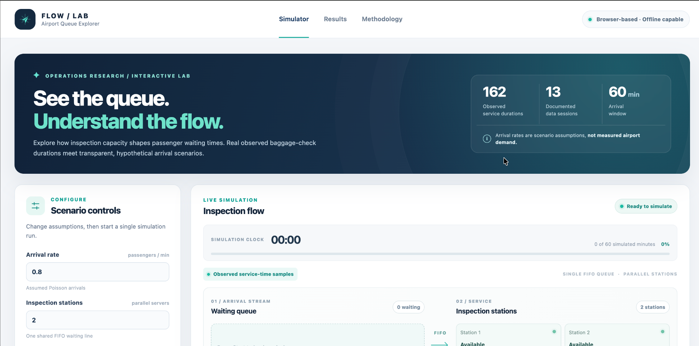
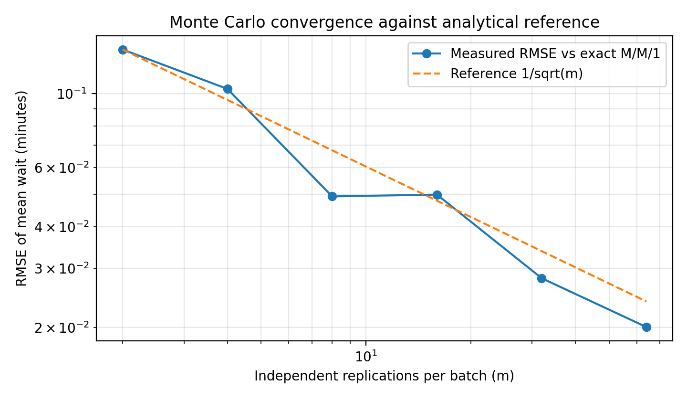
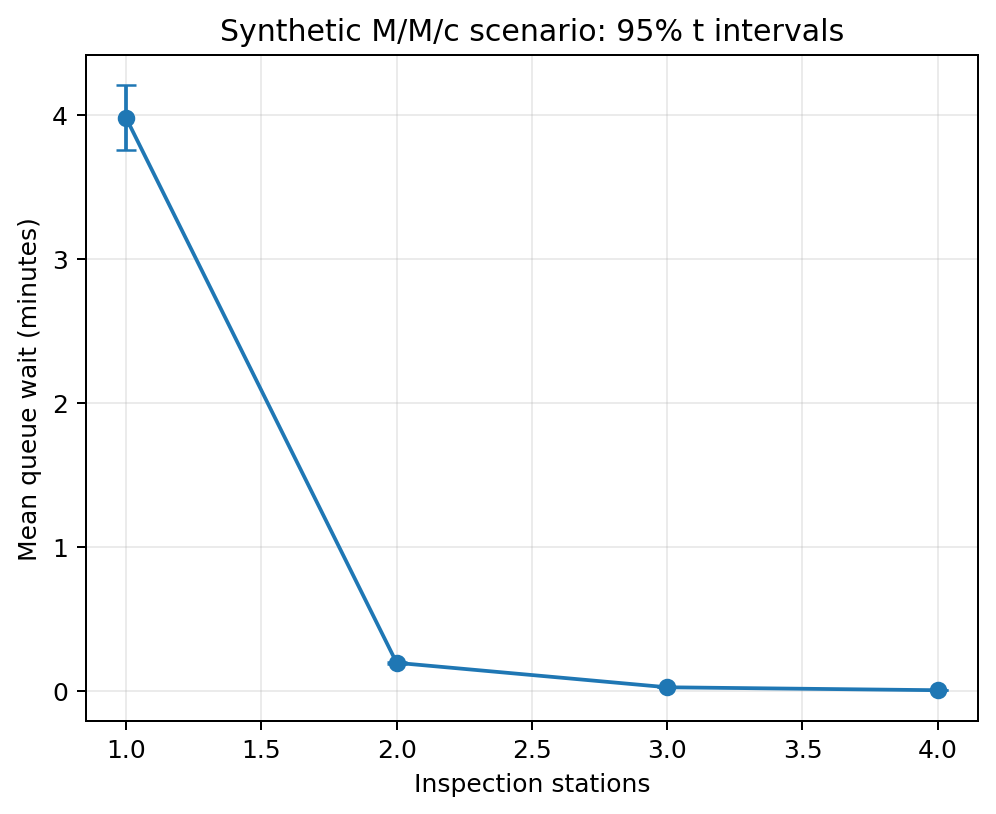
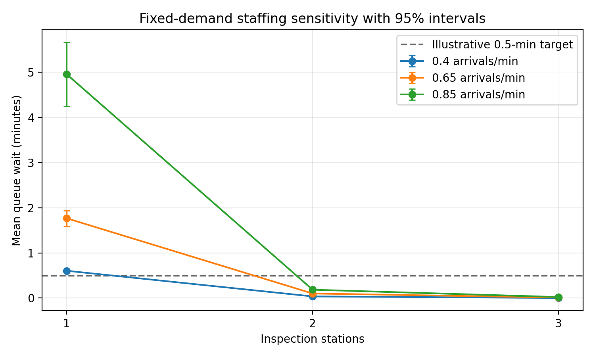

# Airport Baggage Inspection Queue Simulator

A data-informed discrete-event simulation studying how the number of parallel baggage-inspection stations affects passenger waiting under **explicitly hypothetical** arrival conditions.

**[Live interactive demonstration](https://kawanrupasinghe.github.io/airport-baggage-queue/)** · [](https://colab.research.google.com/github/KawanRupasinghe/airport-baggage-queue/blob/main/notebook/airport-baggage-queue.ipynb)



## The problem

One shared first-in, first-out (FIFO) waiting line feeds `c` identical manual baggage-inspection stations. Passengers arrive irregularly, while inspection durations vary. How much does adding capacity reduce waiting under a given assumed arrival rate? The main illustrative service criterion is a 0.5-minute mean queue wait, not an operational target established by an airport.

## Quick start

**Notebook:** Open the Colab badge above and choose **Runtime → Run all**. The notebook reads the published cleaned CSV when needed, tests the simulator and generates statistical results, figures and downloadable output tables. Network access is needed to fetch the CSV in fresh Colab sessions.

**Browser:** Open the [live demo](https://kawanrupasinghe.github.io/airport-baggage-queue/), or download the repository and open `docs/index.html` locally. The simulation runs in JavaScript without a server.

**Python command-line tests** (Python and Node.js are required for cross-language checks):

```bash
python -m pip install -r requirements.txt
python -m pytest -q
node tests/test_browser.js
```

## Model and mathematics

- M/M/c **analytical baseline:** independent Poisson arrivals and exponential inspection times; used to verify the queue engine against Erlang-C.
- M/G/c **data-informed model:** the same assumed arrival process, but inspection times are independently sampled with replacement from a cleaned empirical distribution.
- **FIFO event engine:** process passenger arrivals and station completions in time order; update queue and occupancy areas at each event.
- **Stability:** traffic intensity `rho = lambda * mean_service_minutes * multiplier / c`; for a stationary infinite-buffer model, `rho < 1` is required for a finite steady-state waiting-time mean.

See [theory and assumptions](THEORY.md) and [input-data audit](data/README.md).

## Real data and provenance

The service input comes from the [Airport Security Checkpoint Data](https://doi.org/10.4121/uuid:6246e6a6-d149-420f-a6a4-7afd08f154b5), TU Delft / 4TU.ResearchData, licensed under **CC BY 4.0**. The primary cleaned extract contains **162 positive manual baggage-check durations** from **13 documented sessions**: mean **59.97 seconds**, median **42 seconds**. Two source spreadsheet tabs absent from the documented session list are excluded transparently; see [data/README.md](data/README.md).

**Important:** These are recorded *inspection durations*, NOT measured arrival times to a shared queue. Arrival intensities, FIFO pooling and station counts are hypothetical model inputs, not facts about Rotterdam The Hague Airport operations.

## Verification

- The three-passenger hand trace (arrivals `[0, 1, 1.5]` minutes; services `[3, 2, 1]` minutes; one station) has waits `[0, 2, 3.5]` minutes and mean `11/6 = 1.833333` minutes.
- A stable M/M/2 reference has an analytical mean wait of **0.1905 min**; 30 seeded replications estimated **0.1944 min**, 95% CI **[0.1898, 0.1991]**.
- An independent earliest-available-station implementation agrees on seven fixed/randomised FIFO traces; Python and JavaScript are compared on identical fixed event traces.
- Direct Monte Carlo RMSE against the known M/M/1 mean decays as replications increase; measured log-log slope **−0.554**, versus theoretical sampling reference **−0.5**.





Full [verification evidence](VERIFICATION_EVIDENCE.md) includes methods and caveats.

## Concepts applied

| Numerical/simulation concept | Where it appears |
|---|---|
| Event-driven discrete-event simulation | FIFO queue, arrival/departure events and busy-server states in Python and JavaScript |
| Queueing theory and analytical benchmarking | Erlang-C M/M/c and closed-form M/M/1 waiting-time comparisons |
| Pseudorandom sampling and empirical input modelling | Seeded exponential interarrival generation, service-duration resampling and source cleaning |
| Monte Carlo estimation and law of large numbers | Independent replications, Student-t confidence intervals and RMSE convergence experiment |
| Sensitivity and stability analysis | Demand, inspection stations, service multiplier and explicit overloaded-case exclusion |

## Results

The systematic 3 × 3 × 3 grid varies assumed arrivals **0.40, 0.65, 0.85 passengers/min**, **1–3 stations** and service-time multipliers **0.8, 1.0, 1.2**. It uses independent replications for each stable cell and marks the overloaded `lambda=0.85, stations=1, multiplier=1.2` case as unstable.

At **0.65 assumed arrivals/min** and multiplier **1.0**, waiting-time estimates are:

| Stations | Mean waiting time (min) | 95% replication CI (min) |
|---|---:|---|
| 1 | 1.767 | 1.595–1.938 |
| 2 | 0.101 | 0.092–0.111 |
| 3 | 0.012 | 0.009–0.015 |

Two stations are the smallest **tested** option meeting the illustrative 0.5-minute mean-wait target with the upper confidence bound below that threshold. This is a scenario-conditional simulation comparison, **not validated real-airport staffing advice**.



## Web demonstration

The browser page provides arrival-rate, station-count, inspection-duration multiplier, service-model and speed controls; queue/station animation; a sampled queue-history graphic; live counters; Start, Pause/Resume, Reset and a deterministic reference trace. Its result is **one realised finite run** and should not be interpreted as an across-replication confidence interval. [Read the user guide](USER_GUIDE.md).

## Repository structure

```text
airport-baggage-queue/
├── data/            # Derived service observations, cleaning audit and provenance
├── docs/            # Standalone GitHub Pages dashboard
├── figures/         # Actual demo screenshot and reproduced numerical figures
├── notebook/        # Executable analysis and Monte Carlo experiments
├── src/             # Python event engine and documented data cleaner
├── tests/           # Deterministic and cross-language tests
├── README.md, THEORY.md, USER_GUIDE.md, REFERENCES.md
├── VERIFICATION_EVIDENCE.md
├── requirements.txt, .gitignore, LICENSE
```

## Limitations and future work

Station speeds are assumed identical, arrivals are hypothetical, recorded service times are pooled and independently resampled, and no priorities, abandonment, operator breaks or multi-stage screening are modelled. The sample's representativeness cannot be guaranteed. Future work could obtain queue-entry timestamps and actual staffing schedules to validate waiting-time predictions, then assess multiple warm-up periods and service-time dependence.

## References, AI assistance and licence

See [REFERENCES.md](REFERENCES.md). Software is provided under [MIT](LICENSE); derived service observations require attribution to the original data creators under **CC BY 4.0**. AI-assisted modelling, programming and writing were reviewed through numerical checks and source attribution; code history and model assumptions remain publicly auditable. Full interaction records are maintained privately, not within this repository.
