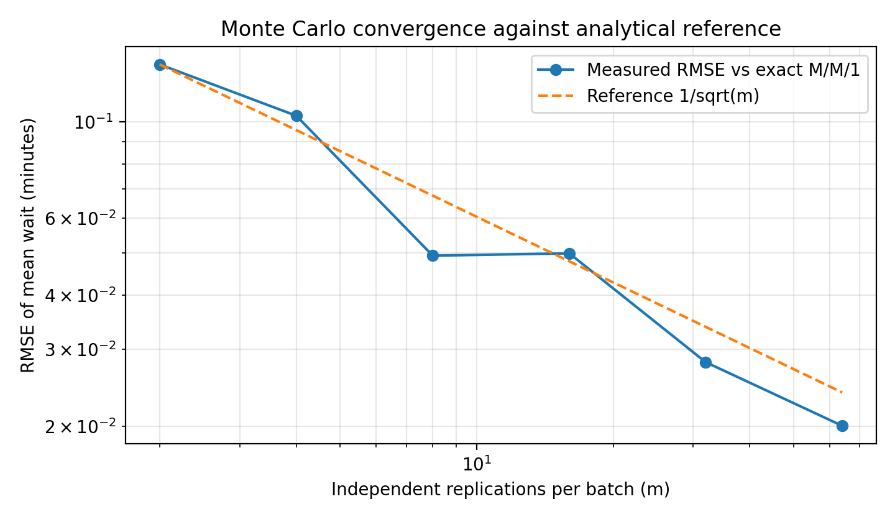

# Numerical verification and implementation evidence

This file connects publicly reproducible source tests, notebook figures and exact reference values. All statements concern **model verification**, not real-airport validation.

| Check | Method | Expected or reference | Recorded result |
|---|---|---|---|
| FIFO hand trace | One station; arrivals `[0, 1, 1.5]`, services `[3, 2, 1]` min | Waits `[0, 2, 3.5]`, mean `11/6` min | Exact in Python and JavaScript reference tests |
| Zero-wait limiting case | Separated arrivals 0, 10, 20 and one-minute service | Mean queue wait 0 min | Exact in Python tests |
| Simultaneous-arrival FCFS | Arrivals `[0,0,0]` with two stations | Waits `[0,0,1]` min | Exact in Python tests |
| Queue-area arithmetic | Arrivals `[0,1]`, services `[3,1]` on one station | Mean queue length `2/4=0.5`, utilisation 1 | Exact in Python tests |
| Origin-time convention | First passenger arrives at minute 5 | Mean queue length `5.5/11` and utilisation `6/11` | Exact in Python tests |
| Cross-language agreement | Pass identical fixed event traces to Python and JS | Identical waits, mean queue, mean wait, utilisation | Five case fixtures, tolerance `1e-10` |
| Independent FIFO algorithm | Alternative earliest-free-station calculation | Agreement with next-event DES | Seven fixed/randomised traces passed in notebook |
| Erlang-C M/M/2 reference | `lambda=0.8`, `mu=1`, 2 stations | Analytical `0.1905` min | 30-replication mean `0.1944`; 95% CI `[0.1898,0.1991]` |
| Analytical M/M/1 RMSE | Compare replication-batch estimates to exact `1.222222` min | Sampling-reference slope approximately `−0.5` | Measured log-log slope `−0.554`, finite-batch uncertainty acknowledged |
| Empirical overload guard | `lambda=.85`, c=1, service multiplier 1.2 | `rho≈1.0195` → unstable steady state | Result labelled `UNSTABLE`, mean waiting time omitted |



## Run tests

```bash
python -m pip install -r requirements.txt
python -m pytest -q
node tests/test_browser.js
```

The notebook is executable through its [Colab link](https://colab.research.google.com/github/KawanRupasinghe/airport-baggage-queue/blob/main/notebook/airport-baggage-queue.ipynb). The tests concern implementation behaviour, random input generation and Monte Carlo sampling error. The real-world input calibration covers only 162 source-documented manual baggage-check durations; arrivals and staffing are assumed.
